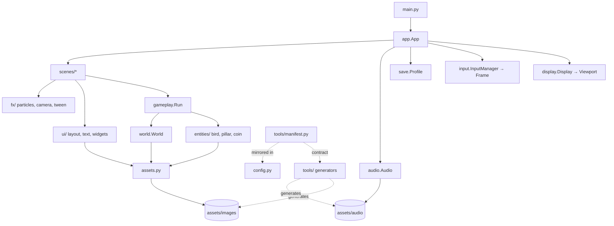

# Architecture

For a developer taking the codebase over. It covers how the pieces fit, and — more usefully — why
each of the five or six load-bearing decisions was made, because those are the ones that look
arbitrary until you try to change them.

Everything here was read out of the code rather than remembered. Where a number appears, it is
named so you can check it.

## The shape of it

```
                       main.py
                          |
                    featherdash.app.App          window + loop + scene stack
                          |
        +-----------+-----------+-----------+
        |           |           |           |
     Display    InputManager  Profile     Audio          platform.py
     (Viewport)  (Frame)    (profile.json) (sfx + beds)  IS_ANDROID, paths,
        |           |           |           |            haptics, screen-on
        +-----+-----+-----------+-----------+
                 |
              Scene  (menu | game | shop | settings)
                 |
        +--------+---------+-----------+
        |                  |           |
      Run (gameplay)     World       ui/ + fx/
        |                  |
   entities/           parallax, sky,
   bird, pillars,      ground, themes
   coins
                 \        /
                  assets.py          scale + nine-slice + cache
                      |
                   assets/           generated by tools/
```



The dependency direction is strict and worth preserving: `platform` → `config` → `display` →
`assets` → everything else. Nothing low in that chain imports anything above it, which is why the
simulation can be constructed and stepped in a test without a window.

## Module map

| Module | Responsibility | The thing to know |
| --- | --- | --- |
| `main.py` | Entry point | Deliberately thin. python-for-android launches this file by name; it must not do anything that can fail before the app can report an error. |
| `featherdash/platform.py` | OS detection, paths, haptics | The only module that knows what a phone is. Android detection prefers p4a's environment variables and refuses to be fooled by a stray importable directory called `android`. |
| `featherdash/config.py` | Every tuning constant | One file, no magic numbers elsewhere. Also mirrors the subset of the art contract the runtime needs, because `tools/` is excluded from the Android bundle. |
| `featherdash/display.py` | `Viewport` and `Display` | The world-unit mapping. See below. |
| `featherdash/assets.py` | Loading, scaling, caching, nine-slice | Never raises. A missing image becomes a magenta placeholder. |
| `featherdash/save.py` | `Profile` | Atomic writes, versioned migration, degrades to defaults. |
| `featherdash/input.py` | Events → one `Frame` | De-duplicates SDL's synthetic touch-mouse events in one place. |
| `featherdash/app.py` | Window, loop, scene stack | The fixed-timestep accumulator lives here. |
| `featherdash/audio.py` | Sound effects and the music beds | numpy-free by design: pitch variants are pre-rendered by `gen_audio.py` and chosen at play time, because `pygame.sndarray` would need numpy and numpy is not in the APK. Channels 0–1 are reserved for the two music beds (so one can cross-fade into the other) and 2–4 for critical cues, because a flap fires ten times a second and would otherwise own every channel and silently drop the death sound. Degrades to silence, never to an exception. |
| `featherdash/world.py` | Sky, parallax, ground, themes | Draws across the *visible* bounds, not the play area, so overscan is scenery rather than black. |
| `featherdash/gameplay.py` | `Run` — one playthrough | Display-independent simulation that reports what happened via `Events`. |
| `featherdash/entities/` | `Bird`, `PillarPair`, `Coin` | Simulated objects; all dimensions in world units. |
| `featherdash/fx/` | Particles, camera, tweens, easing | The particle pool allocates nothing during play. |
| `featherdash/ui/` | Layout, text, widgets | Lays out against the viewport's **safe area**, never its raw edges. |
| `featherdash/scenes/` | `menu`, `game`, `shop`, `settings` | Each owns its input, simulation and drawing. |
| `tools/` | The asset pipeline | NumPy + Pillow. Build-time only; never imported by the game. |

## World units: the coordinate system

**Nothing in the game is measured in pixels.** The world is `config.WORLD_H = 1080` units tall,
always, on every device. `display.compute(screen_w, screen_h)` derives a frozen `Viewport` that
maps those units onto the current framebuffer:

```
scale      = screen_h / WORLD_H              pixels per world unit
units_wide = screen_w / scale                how wide this screen is, in world units
world_w    = clamp(units_wide, 560, 1040)    the guaranteed play area
origin_x   = (screen_w - world_w * scale) / 2
```

Three consequences fall straight out of that:

1. **Vertical scale is constant**, so a 302-unit gap is the same fraction of screen height
   everywhere. The game is exactly as hard on every device — which is not true of any
   pixel-authored game.
2. **Horizontal extent flexes** with the aspect ratio. A wider screen shows more scenery. The clamp
   at `WORLD_W_MAX = 1040` exists because seeing further ahead is a real competitive advantage;
   `WORLD_W_MIN = 560` exists because below it the gap stops being readable.
3. **Surplus screen becomes overscan, not letterboxing.** `view_left`/`view_right`/`view_top`/
   `view_bottom` describe everything actually visible, which may exceed the play area. The backdrop
   draws to those bounds while gameplay stays inside the guaranteed box. There are never black bars
   and never stretched art.

One exception to height-anchoring: on a display so tall and narrow that height-anchoring would push
the play area below `WORLD_W_MIN`, `compute()` anchors to width instead and lets the surplus
*height* overscan.

### Using it

```python
vp.px(u) / vp.ipx(u)        # world length → pixels (float / rounded int)
vp.to_screen(x, y)          # world point  → pixel point
vp.to_screen_i(x, y)        # ...rounded, for blitting
vp.to_world(sx, sy)         # pixels → world; this is how touch input is read
vp.rect(x, y, w, h)         # world box → pygame.Rect, rounded so adjacent rects never gap
vp.cx, vp.cy, vp.ground_y, vp.bird_x                 # layout anchors
vp.safe_left() / safe_top() / safe_right() / safe_bottom()   # UI bounds
vp.view_left / view_right / view_top / view_bottom           # visible overscan bounds
```

The rules that keep this working:

- **Convert at draw time, never at author time.** A thing that is 100 units wide is `vp.px(100)`
  pixels in the draw call, and still 100 units in the model.
- **UI anchors to `safe_*()`, not to 0 and `world_w`.** A fullscreen Android app has a camera
  cutout over the top and a gesture handle over the bottom; a button on the literal screen edge is
  a button some players physically cannot press. `Display._query_safe_insets()` reads the real
  insets through JNI, and `FEATHERDASH_SAFE_INSETS=l,t,r,b` fakes them on desktop for testing.
- **A `Viewport` is frozen.** The window changing shape produces a new one; it is never mutated.
  `Display.sync()` is called every frame because Android resizes the surface on rotation and when
  the system bars appear without always sending a `VIDEORESIZE`. When it reports a change,
  `App._on_resize()` drops the scaled-asset caches and tells every scene to re-derive its layout.

## The frame loop

`App._loop()`, a standard accumulator:

```
frame_time = clock.tick(TARGET_FPS) / 1000
frame_time = min(frame_time, MAX_FRAME_TIME)      # 0.25 s stall clamp

display.sync()          →  if changed: invalidate caches, re-layout scenes
input.poll(viewport)    →  Frame
scene.handle(frame)                                variable rate, once per frame

accumulator += frame_time
while accumulator >= PHYSICS_DT and steps < 8:     fixed rate, 1/120 s
    scene.step(PHYSICS_DT)
    accumulator -= PHYSICS_DT
if steps == 8: accumulator = 0                     give up rather than spiral

alpha = accumulator / PHYSICS_DT                   0..1 between the last two steps
scene.update(frame_time)                           animation only, never gameplay
audio.update(); camera.update(); particles.update()
scene.draw(surface, viewport, alpha)
pygame.display.flip()
apply any queued scene change
```

Why it is built this way:

- **`PHYSICS_HZ = 120`, fixed.** Gameplay advances in identical slices regardless of refresh rate,
  so the game feels the same at 60, 90, 120 and 144 Hz. The common alternative — moving things by a
  fixed amount per frame — makes a game literally twice as fast on a 120 Hz panel.
- **`step` and `update` are separate, and the split is enforced by convention.** `step(dt)` always
  receives `config.PHYSICS_DT` and may change gameplay state. `update(dt)` receives real frame time
  and must only animate. Putting gameplay in `update` reintroduces frame-rate dependence through
  the back door, and it is the single easiest mistake to make in this codebase.
- **`draw` receives `alpha`** so rendering can interpolate between the last two simulation states
  and motion stays smooth at rates that are not a multiple of 120.
- **`MAX_FRAME_TIME = 0.25` and the 8-step cap.** A breakpoint, a garbage-collection pause or the
  app returning from the background would otherwise be simulated all at once — the player dies
  while they were not looking. Both limits discard time instead.
- **`TARGET_FPS` is 60 on mobile and uncapped on desktop**, where vsync paces the loop.

## Scenes

`Scene` (`featherdash/scenes/base.py`) is a plain interface, not a framework:

| Method | When | Rules |
| --- | --- | --- |
| `enter(**kwargs)` / `leave()` | On becoming / ceasing to be current | Scenes are constructed once at startup and reused, so `enter` must reset state. |
| `handle(frame)` | Once per frame | The only place input is read. |
| `step(dt)` | 0–8 times per frame | `dt` is always `PHYSICS_DT`. Gameplay goes here. |
| `update(dt)` | Once per frame | Animation only. |
| `draw(surface, vp, alpha)` | Once per frame | Interpolate with `alpha`. |
| `on_resize(vp)` | Viewport changed | Re-derive cached layout. Called on *every* scene, not just the current one. |
| `on_focus_lost()` | Backgrounded | The game scene pauses here — dying in the app switcher is unforgivable. |

The four scenes are registered in `App._register_scenes()` and keyed by their `name` attribute:
`menu`, `game`, `shop`, `settings`. Transitions go through `App.go("name", **kwargs)`, which
**queues** the change and applies it at the end of the frame — switching scenes mid-frame would
leave the loop stepping one scene and drawing another. `App._apply_pending()` also clears held
pointers, so a finger still down when the screen changes cannot act on the new one.

The play screen runs a second, smaller state machine inside itself, because tutorial, pause and
results are all overlays on the same live simulation rather than separate screens:

```
GameScene.Phase:   TUTORIAL ──tap──► PLAYING ──pause──► PAUSED ──resume──► PLAYING
                                        │                   └──home──► menu
                                        └──death──► RESULTS ──retry──► TUTORIAL
                                                            └──home──► menu

Run.RunState:      READY ──flap──► PLAYING ──collision──► DYING ──lands──► DEAD
```

`Run` (in `gameplay.py`) is the simulation and knows nothing about presentation: it owns the bird,
the pillars, the coins, the score and the difficulty curve, and reports what happened through an
`Events` object the scene drains each frame to decide what to play, shake and spawn. That is what
lets `tests/autoplay.py` run thousands of simulated games headlessly, and it is worth preserving —
pushing sound or particles into `Run` would end it.

Difficulty is a single normalised value, `Run.difficulty`, which is `smoothstep(score / RAMP_SCORE)`
— eased rather than linear so the ramp arrives gently — and `speed`, `gap_size` and `spacing` are
each a lerp between their `_START` and `_END` constants along it.

## Gameplay: dash and pace

Two mechanics sit on top of the basic flap, and both are deliberately expressed in terms that can
be reasoned about rather than tuned by feel alone.

**The dash** lives entirely in `Bird`. The bird keeps a `base_x` anchor and a `dash_offset`, and
`x` is a property returning their sum — so a window resize can move the anchor without cancelling
a dash in flight, and `reset()` can clear the offset without disturbing the anchor. The offset
follows a cubic ease out to `config.DASH_DISTANCE`, holds, then eases back with a smoothstep;
mid-dash, gravity is scaled by `DASH_GRAVITY_SCALE` and vertical velocity is bled off
exponentially, which is what makes the bird hold a line instead of arcing out of the gap.

It grants no invulnerability. That is the design: collision runs unchanged during a dash, so the
move can kill you, which is what keeps it a decision rather than an escape button. `dash_charge`
exposes the cooldown as 0..1 for the HUD arc.

**Game pace** is anchored to version 1 rather than to an arbitrary number. `config.LEGACY_SPEED`
is 259.2 world units per second, which is exactly what version 1 scrolled at — 2.4 px
per frame at 60 fps in a 600 px-tall window, scaled into this game's 1080-unit world. The player
picks a multiplier from `config.SPEED_PRESETS` (0.5x to 4x), stored in `profile["speed_scale"]`,
and `Run.speed` is `LEGACY_SPEED * speed_scale * ramp`, where the ramp climbs to
`SPEED_RAMP_FACTOR` across the first `RAMP_SCORE` points. The 1.25x default reproduces the
hand-tuned curve that preceded the setting, and 1.0x is version 1's pace exactly.

`clamp_speed_scale()` guards the range, because the profile is a plain JSON file on the device and
a hand-edited value large enough would let a pillar cross the bird inside one physics step.
`tests/test_dash_speed.py` asserts that cannot happen even at 4x with a dash in progress.

## The asset pipeline

```
tools/manifest.py        the contract: filenames, source sizes, palettes, inventory
        │
        ├─► tools/artlib.py          drawing primitives (PIL + NumPy, supersampled 4x)
        │        │
        │        ├─► gen_bird.py     6 skins x 4 frames
        │        ├─► gen_world.py    sky, far/mid/near, ground, clouds x 4 themes
        │        ├─► gen_props.py    pillars, coins, particle textures
        │        ├─► gen_ui.py       panels, buttons, icons, medals, logo
        │        └─► gen_brand.py    store icon, adaptive layers, presplash, feature graphic
        │
        └─► gen_audio.py             sfx + one looping music bed per theme, + index.json
                 │
                 ▼
            assets/images/*.png      authored at ~2x their largest on-screen size
            assets/audio/*.wav
            assets/audio/index.json  which variants exist, readable with the stdlib
                 │
                 ▼
         featherdash/assets.py       original() → scaled() → cache → blit
```

Five properties of this pipeline matter when you change it:

1. **`tools/manifest.py` is the single source of truth** for every filename and source size, and
   `manifest.expected_images()` enumerates the whole inventory. A name can only ever be defined
   once.
2. **`config.py` mirrors the runtime-relevant subset** — themes, skins, icon names, medals, frame
   counts. It must, because `tools/` is excluded from the Android bundle (it would drag in NumPy
   and Pillow, which the game never needs). `tests/test_contract.py` fails if the two drift apart,
   and also asserts the game never imports a build-only module.
3. **Nothing is sampled, traced or downloaded.** Every pixel and every sample is computed from
   primitives. This is a commercial property as much as a technical one — see
   [CREDITS.md](CREDITS.md).
4. **Each generator verifies its own output** and exits non-zero on failure: sizes, alpha ranges,
   corner transparency, seam scores for tiling layers, loop continuity for music, and the
   adaptive-icon safe circle. Running a generator *is* its test.
5. **Scaling happens once per size and is cached.** `assets.scaled(name, w, h)` keys on the exact
   pixel size; `invalidate_scaled()` drops the caches when the viewport changes, so a resize costs
   one rescale rather than one per frame. `NineSlice` stretches panels and buttons to any size
   without distorting their corners. Nothing raises: a missing file logs once and returns a magenta
   placeholder, which keeps the game running while art is still being produced and turns a
   packaging mistake into something obvious on screen.

## The save file

One JSON object at `<data_dir()>/profile.json`, where `data_dir()` is the app's private directory
on Android and the platform convention on desktop (`~/Library/Application Support/FeatherDash`,
`%APPDATA%\FeatherDash`, `$XDG_DATA_HOME/FeatherDash`).

```json
{
  "version": 1,
  "high_score": 0,
  "feathers": 0,
  "total_feathers_earned": 0,
  "games_played": 0,
  "total_score": 0,
  "best_medal": null,
  "skin": "ember",
  "unlocked": ["ember"],
  "sfx": true,
  "music": true,
  "haptics": true,
  "show_fps": false,
  "seen_tutorial": false,
  "best_run_seconds": 0.0,
  "total_distance": 0.0
}
```

Four decisions, each paid for by a real failure mode:

- **Writes are atomic** — temp file in the same directory, `fsync`, then `os.replace`. A phone can
  be killed at any moment, and the most likely moment is exactly when the player backgrounds the
  app on death, which is also when the file is being written. The old file survives until the new
  one is completely on disk.
- **Loading never raises.** A missing, truncated, corrupt or hand-edited file degrades to defaults.
  Each value is additionally type-checked against its default, so a string where a number belongs
  cannot crash a frame later.
- **A read-only filesystem is survivable.** `save()` sets `_readonly` and the game continues
  entirely in memory.
- **Migration is keyed on `version`** and additive (`Profile._migrate`). Bump `SAVE_VERSION`, add a
  branch, never rename an existing key.

`record_run(score, feathers, seconds, distance)` folds one run in and returns
`{"new_best": bool, "medal": str | None, "new_medal": bool}` — the results screen's flourishes are
driven from that rather than recomputed.

## Android packaging

```
buildozer.spec  ──►  packaging/android/build.sh  ──►  Docker (packaging/android/Dockerfile)
                                                          │
                                                   buildozer + python-for-android
                                                          │
                                                     bin/*.apk  |  bin/*.aab
```

buildozer does not run on macOS, so every build happens inside a pinned Ubuntu 22.04 image (22.04
deliberately: it ships Python 3.10, and some p4a recipes still reach for `distutils`, which 3.12
removed). The project is *mounted* at `/workspace` rather than copied in, so editing a source file
does not invalidate the image and force a 45-minute rebuild of the SDK, NDK and cross-compiled
CPython. The SDK/NDK, gradle and ccache directories are named volumes, which is what turns a cold
build into a three-minute warm one.

```bash
packaging/android/build.sh debug | install | logcat | release | validate | shell | image | clean
packaging/android/make_keystore.sh        # once, ever; writes outside the repository
```

What `buildozer.spec` pins, and why each matters:

| Key | Value | Why |
| --- | --- | --- |
| `package.domain` + `package.name` | `com.varshraj` + `featherdash` | Must equal `platform.APP_ID`; unchangeable after the first publish. |
| `android.api` / `minapi` / `ndk_api` | 36 / 24 / 24 | Play enforces a recent target API, with the deadline moving each August. |
| `android.archs` | `arm64-v8a, armeabi-v7a` | 64-bit is mandatory on Play; the Python runtime is native code. |
| `android.release_artifact` | `aab` | New apps must ship as App Bundles. |
| `android.permissions` | `VIBRATE` only | The haptic tick. No `INTERNET` — the game makes no network calls and the listing says so. |
| `source.exclude_dirs` | `tools, tests, docs, store, Images, Sounds, Fonts, …` | Keeps NumPy/Pillow-dependent code and undocumented legacy media out of the bundle. |
| `version.filename` / `version.regex` | `featherdash/__init__.py` | The version is single-sourced; bump `__version__` and nothing else. |
| `orientation` / `fullscreen` | `portrait` / `1` | `app.main()` also sets `SDL_HINT_ORIENTATIONS` on mobile. |

The Android-specific code paths all funnel through `platform.py`: `data_dir()` returns the private
directory p4a provides (writing anywhere else is denied on modern API levels), `vibrate()` goes
through plyer, `keep_screen_on()` and the display-cutout query go through pyjnius/JNI. Every one of
them is wrapped so that a device without the capability degrades silently instead of crashing.

## Testing and conventions

```bash
SDL_VIDEODRIVER=dummy SDL_AUDIODRIVER=dummy .venv/bin/python -m pytest tests/ -q
SDL_VIDEODRIVER=dummy SDL_AUDIODRIVER=dummy .venv/bin/python tests/autoplay.py
```

`tests/conftest.py` forces the dummy video and audio drivers, so the suite runs with no window and
no sound device — the same way CI runs it. `tests/autoplay.py` is the most valuable of them: a
headless bot plays full games at several viewport shapes, and if a straightforward controller
cannot survive, the physics, the gap sizing or the difficulty ramp has been broken. That is a far
better signal than a unit test on any individual constant.

House rules, in rough order of how much damage breaking them does:

1. **World units everywhere.** Never hardcode a pixel size. Convert through the `Viewport` at draw
   time.
2. **Gameplay in `step`, animation in `update`.** Never the other way round.
3. **Tuning constants live in `config.py`.** If you are typing a number into a scene, it belongs
   there instead.
4. **The game imports nothing from `tools/`.** NumPy and Pillow are not in the APK.
5. **Asset loaders degrade, never raise.** The game must survive a missing file.
6. **UI anchors to the safe area**, not to the screen edge.
7. **Python 3.9+, type-hinted, `from __future__ import annotations` at the top of every module.**
8. **Comments explain why, not what.**
